# Hi there

<picture>
  <source media="(prefers-color-scheme: dark)" srcset="https://raw.githubusercontent.com/souta-pqr/souta-pqr/output/stats-dark.svg">
  <source media="(prefers-color-scheme: light)" srcset="https://raw.githubusercontent.com/souta-pqr/souta-pqr/output/stats-light.svg">
  
</picture>

<picture>
  <source media="(prefers-color-scheme: dark)" srcset="https://raw.githubusercontent.com/souta-pqr/souta-pqr/output/skyline-dark.svg">
  <source media="(prefers-color-scheme: light)" srcset="https://raw.githubusercontent.com/souta-pqr/souta-pqr/output/skyline-light.svg">
  
</picture>
